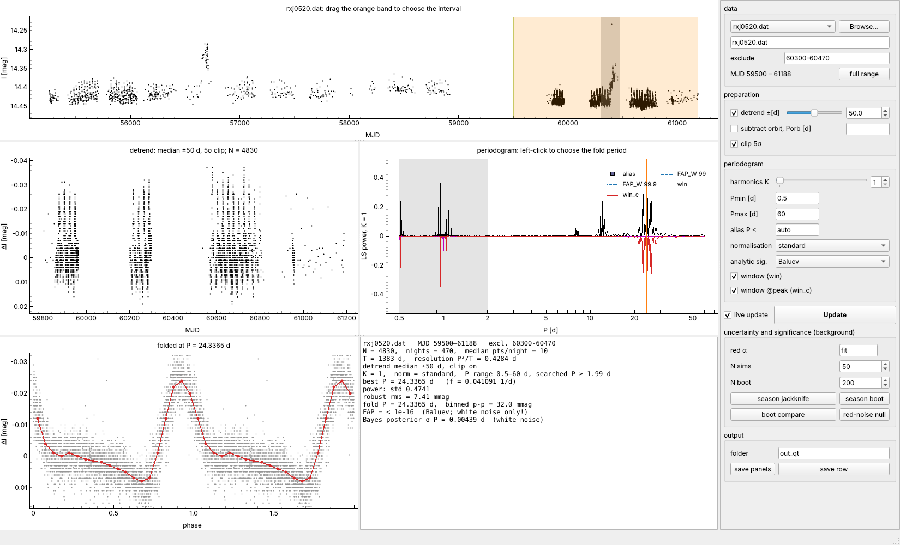

# OGLE explorer

Interactive period search for OGLE light curves, but should work with any ascii data file having a similar structure (time, mag, error).
The worked example is the orbital period of the Be/X-ray binary RX J0520.5−6932 in the LMC.



The tool covers what usually goes wrong in a period search:

* **detrending** with a running median, sigma clipping, subtracting a known orbit before a search for non-radial pulsations (NRPs)
* **Lomb–Scargle** with K harmonics and several normalisations (standard, psd, model, log, Bayesian posterior)
* **aliases**: the spectral window W(f), the alias pattern of the peak, and a shaded alias region that is not searched
* **significance**: analytic false-alarm levels for white noise (Baluev, Beta tail), and a red-noise null from
  Timmer & Koenig simulations at the real sampling times, with the slope set or fitted
* **period uncertainty**: point, night and season bootstraps, season jackknife, the analytic white-noise
  formula, and the Bayesian posterior width, all side by side
* **output**: each panel as a PNG, plus one row per analysis appended to a CSV/ECSV results table

## Install

Python ≥ 3.9. A fresh environment is recommended:

```bash
python -m venv .venv && source .venv/bin/activate      # Windows: .venv\Scripts\activate
pip install git+https://github.com/<user>/ogle-explorer.git
```

or from a downloaded copy of this repository:

```bash
pip install .            # add -e to edit the code in place
```

pip installs all dependencies (numpy, scipy, astropy, matplotlib, PySide6, pyqtgraph).

## Getting the data

`scripts/get_ogle_xrom.sh` downloads the I-band photometry (`phot.dat`) of every source in the
[OGLE X-Ray Sources Monitor (XROM)](https://ogle.astrouw.edu.pl/ogle4/xrom/xrom.html) into one folder, naming each
file after its source:

```bash
bash scripts/get_ogle_xrom.sh             # -> OGLE_XROM/sxp0.09.dat, OGLE_XROM/rx-j0520.5-6932.dat, ...
bash scripts/get_ogle_xrom.sh -m 'sxp*'   # only SMC pulsars (shell pattern on the folder name)
bash scripts/get_ogle_xrom.sh -f          # refresh: re-download existing files
cd OGLE_XROM && ogle-explorer             # every source appears in the file list
```

The script needs curl or wget. You can re-run it safely: existing files are skipped unless you pass `-f`. Please acknowledge OGLE/XROM
(Udalski et al. 2008, 2015) when you use the data.

## Run

```bash
cd folder_with_dat_files
ogle-explorer                                         # pick a *.dat file from the list
ogle-explorer rxj0520.dat --exclude 60300-60470 --alias auto
ogle-explorer smc_x3.dat --pmin 0.1 --pmax 3 --porb 44.9    # NRP search, orbit subtracted
```

`python -m ogle_explorer` does the same. `ogle-explorer-mpl` starts the older matplotlib-widgets interface,
which takes the same options. Run `ogle-explorer --help` for all options.

**Input:** OGLE XROM `.dat` files with columns HJD, I, σ_I, … (MJD = HJD − 2400000.5).

## Using the window

| where | what |
|---|---|
| light curve | drag the orange band (or its edges) to select the interval; grey bands are excluded intervals |
| periodogram | left-click to choose the fold period; mouse wheel zooms, left-drag pans, "A" restores the view |
| Update | recomputes (Ctrl+Enter); with **live update** ticked it recomputes automatically |
| uncertainty and significance | bootstraps and red-noise simulations run in the background (progress bar, Cancel) |

Legend: `FAP_W` = analytic white-noise false-alarm levels, `FAP_R 99` = 99 % of the maximum power in red-noise
simulations, `win` = spectral window, `win_c` = window centred on the peak (where the peak's aliases fall).

## Library use

```python
from ogle_explorer import core, tools
t, I, sig = core.load("rxj0520.dat")
r = I - core.running_median(t, I, 50)
```

## Structure

```
src/ogle_explorer/
    qt.py      Qt interface (GUI-free analysis in the class Core)
    mpl.py     matplotlib-widgets interface
    core.py    loading, detrending, normalisations, analytic significance
    tools.py   red-noise (TK95) simulations, PSRESP-like slope fit, spectral window, alias helpers
```
